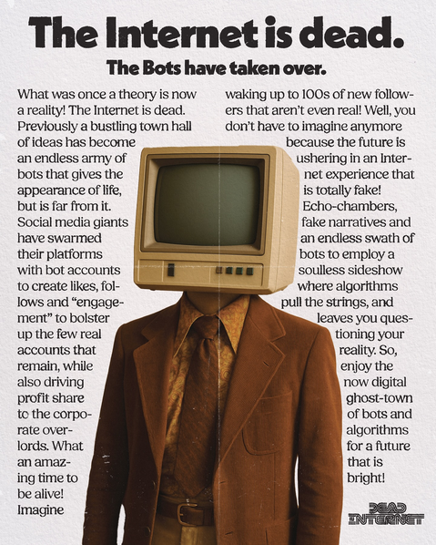

## O De Cómo No Hay Nadie Al Otro Lado: La teoría del internet muerto

Si eres una persona que interactúa con gente en internet, más de una vez te habrá pasado que te han respondido cosas que no correspondían con lo que estabas diciendo, que te han intentado llevar por otros derroteros la conversación o que, directamente, has pensado que la otra persona que está detrás de su monitor simplemente es disfuncional.

¿Cómo te quedarías si te digo que no siempre hay alguien detrás de una pantalla y que es seguro que más de una vez has discutido con un robot? Pues esa misma cara que tienes ahora es la que tuve yo cuando descubrí la [Teoría del Internet Muerto](https://en.wikipedia.org/wiki/Dead_Internet_theory). Para muchos, no es más que una fantasía, pero con la cantidad de vídeos que están circulando con granjas gigantes de bots y cuentas de redes sociales, cada vez es más evidente.

Hace unos años, puede que incluso décadas, la compra de bots para que te hiciesen _follow_ en redes sociales como twitter o instagram era bastante común. De hecho, muchos de los que hoy son influencer por seguidores, lo han sido por pagar por publicidad (en youtube o twitch es bastante evidente cuando alguien paga, pues nos sale a todos el vídeo pese a que no veamos de ese topic) o lo han sido por pagar a empresas que te llenan de bots e interacciones tus redes sociales. Al principio, no era más que un número de usuarios fantasma que poblaban tus publicaciones. Que si likes por aquí, que si retweets por acá... Pero el **algoritmo ha cambiado y la creación de ragebaits lo ha evidenciado.** Las empresas de redes sociales facturan por tracción e interacción. **Es mejor tener 300 personas discutiendo y generando muchas respuestas que 5000 dándole a like sin decir nada.**

Esto ha sido asimilado por las grandes empresas de bots, que poco a poco han ido refinando sus creaciones. Ahora mismo, con las LLM y la supuesta IA, podemos hacer que nuestras cuentas fantasma hagan y digan cosas, incluso que posteen cosas en internet para que sea más real la cuenta. [Se calcula que el 51% de los usuarios de internet son bots](https://reporterzy.info/en/5234,dead-internet-theory-is-a-fact-bots-now-outnumber-people-online), lo que hace que sea más que probable que hayas leído respuestas de bots, visto fotos o vídeos de bots o, incluso, hayas discutido con algún bot que decía estupideces para generar tracción en esa noticia un poco caliente.

Una de las grandes paradojas de esta situación es que los robots necesitan de usuarios para alimentar sus algoritmos y saber cómo actuar. Han de saber qué decir cuando alguien les está acusando de algo en internet. Y tienen miles de ejemplos para poder contestar, pues no hay nada más humano que discutir de trivialidades con alguien de internet. Pero como ahora mismo más de la mitad de los usuarios son robots, está ocurriendo que los robots se están alimentando con contenido de robots, y contestando con cosas que contestaría un robot. Todavía pueden seguir un tiempo hasta que el [**"data poisoning"**](https://genai.owasp.org/llmrisk/llm042025-data-and-model-poisoning/) surta efecto, y para entonces seguro que han encontrado una solución.

{marginnote}Lo de hablar con robots que son insistentes y te persiguen con la línea argumental, aunque esté mal, es el sueño húmedo de Turing.{/marginnote}

Otra de las grandes paradojas, y que da título a esta teoría, es que aquella herramienta que se hizo para conectarnos a todos, nos ha desconectado aún más y nos ha puesto a hablar con robots. El avance tecnológico que supuso internet, fue maldecido y ahora sirve solo para que otros robots te inciten a escribir que están confundidos o que no tienen razón por alguna u otra estupidez que hayan dicho.

# La teoría de la empresa muerta

Cuando trabajas en una empresa el suficiente tiempo puedes llegar a reconocer la manera que tiene de escribir o de expresarse de algunos de tus compañeros. Y es más que evidente cuando quien escribe es otra persona. No es la primera vez que me pasa en una cadena de correos que pides ciertos credenciales, haciendo una mención a aquella persona que te ha resuleto anteriormente los problemas y con la que tienes un trato más cercano, y que me respondan al correo electrónico con un texto que no tiene mucho que ver con el tema que estamos tratando. Muy similar a lo que decía al principio de las interacciónes por internet, y que tras hablar con ellos por privado, hacen la gestión en cuestión de segundos y sin complicación alguna, y contestan por correo de una manera más familiar. Esto me ha llevado a sospechar bastante de los correos y de la gente que, supuestamente, está detrás de la pantalla.

Hablando con compañeros o amigos uno se da cuenta de que cada vez son más las personas que **le pasan la cadena de correos electrónicos a una llm y le preguntan a la IA que les dé una respuesta para esa cadena de correos.** Es más, yo he desarrollado una aplicación exáctamente para ese mismo propósito en uno de mis clientes. Y era una herramienta interna, que ni si quiera es para atención al cliente. Todo ello me hace llegar a concluir que poco a poco estámos entrando en la **Era de la Empresa Muerta.** Una empresa que tiene decisiones tomadas a partir del dato, un dato que es recogido por internet, en redes sociales y por usuarios de a pie. Algunos de ellos son bots, recordemos. Esas decisiones pasan un proceso de traducción a proyectos, gran parte por los project owners o por capas superiores de la cadena, que se ayudan en IA para tomar deciciones en la lectura de sus datos, y esos proyectos son gestionados en su conjunto por trabajadores que usan IA para desarrollar su producto. Todo esto sazonado con dudas, peticiones, emails, conversaciones y reuniones llevadas con agentes de IA y contestadas por agentes de IA.

Las empresas que conforman la **Teoría de la Empresa Muerta** son aquellas que tienen trabajadores como mediadores entre Inteligencias Artificiales. Trabajadores cuyo trabajo puede ser sustituido por las mismas tecnologías que usan, y trabajadores que no aportan nada a nivel productivo más allá de presentar los resultados que el chatbot de turno les ha escupido, o las celdas del excel que su asistente digital ha movido o rehecho. Estas **empresas muertas** conforman el problema de darle luz verde a la Tendencia Decreciente de la Tasa de Ganancia, que ha sido mantenida durante años mediante políticas económicas que luchaban contra ella, pero poco a poco vuelve a ganar hasta que vuelva a causar otra crisis.

Este tipo de empresas no necesairamente han de buscar el máximo rendimiento por trabajador, ni el mayor rédito económico. Es una evolución natural de usar la Inteligencia Artificial para todo lo relacionado con la solución de problemas, y pasar las interacciones humanas por los agentes de IA, para que filtren y busquen la mejor comunicación entre iguales. No viene dictada desde arriba, o busca la eliminación de trabajadores como intermediarios entre la materia prima y el producto final manofacturado o la mercancía (que eso daría para otra teoría completa). Esta teoría entiende como natural la sucesión de eventos ocurridos en la industrialización tecnológica y la desaparición constante de personas detrás de la pantalla. No es que haya bots en lo que antes había puestos de trabajo, que también, sino que las personas que siguen manteniendo su puesto de trabajo son la pizca de sal que hay en los diferentes outputs de la Inteligencia Artificial. **Detrás de esas pantallas hay bots, y detrás de esos bots hay personas.** Esto hace que, principalmente, la comunicación sea entre bots y tenga una pequeña capa personal en cada uno de los outputs.

{marginnote}Se está trabajando con bots, en proyectos generados por bots, analizados por bots, con dudas técnicas y resoluciones gestionadas por bots, y usados en última instancia por bots.{/marginnote}

Todo esto suena tremendista, lo sé. Pero pensad en ello:

Juan recibe un email de Alberto con una petición de solucionar ciertos problemas en el excel corporativo donde tienen los gastos de la empresa a lo largo del año. Este correo electrónico, Juan, lo pasa por una IA que le dice qué es lo que necesita, y una vez que lo sabe, le dice a otra IA que arregle lo que están pidiendo. Una vez arreglado por la IA, le dice otra vez a la primera que le escriba un email corporativo para Alberto explicando qué ha hecho y cómo lo ha solucionado, el cual va a ser recibido, copiado y pegado en otra IA de Alberto para saber si lo que ha hecho está bien. Todo ello, en un proyecto que salió de una necesidad estudiada en los datos, datos extraidos por una IA, y estudiados por una directivo, Santiago, que usó una IA para que le dijese cuales eran las neceisdades de su empresa.

En este ejemplo tenemos la interacción de 3 personas (hecho así para que sea más sencillo), Juan, Alberto y Santiago, que han estado traduciendo y reenviándose cosas que sus inteligencias artificales les han dicho ha ellos. Han estado haciendo que las IAs hablen entre sí, por mediación de los humanos, pero los humanos han imprimido poco o nada de su mano de obra en los proyectos. Todavía encontramos ciertos artesanos digitales que manipulan el excel a mano, leen las cadenas de correos y trabajan en sus herramientas digitales. Pero cada vez son más aquellos que priman la cantidad a la calidad, la primacía a la artesanía, y no hay vuelta atrás. No hay un valor añadido real a las soluciones artesanales cuando son digitales. Poco importa que una aplicación por debajo sea tenga gusto, esté hecha a mano y se hayan aplicado las _muy mejores buenas prácticas_ de programación o de ética empresarial. Al fin y al cabo el usuario final o el jefecillo de turno solo va a ver la superficie, la parte más alta del proceso, y va a transformar ese trabajo en datos, en interacciones, en euros por minuto.

Quizá en un futuro, las empresas muertas puedan trabajar con la fábrica de coches china donde no encienden la luz. Empresas absolutamente oscuras y zombies, que generan productos para que los usen, consuman y aprecien los humanos.

O no.

**¡El futuro es hoy, viejo!**

